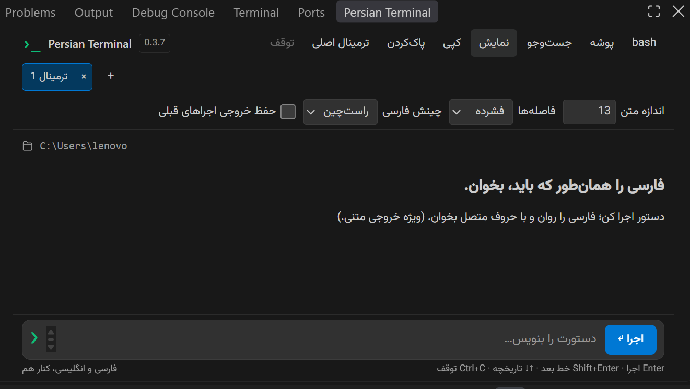
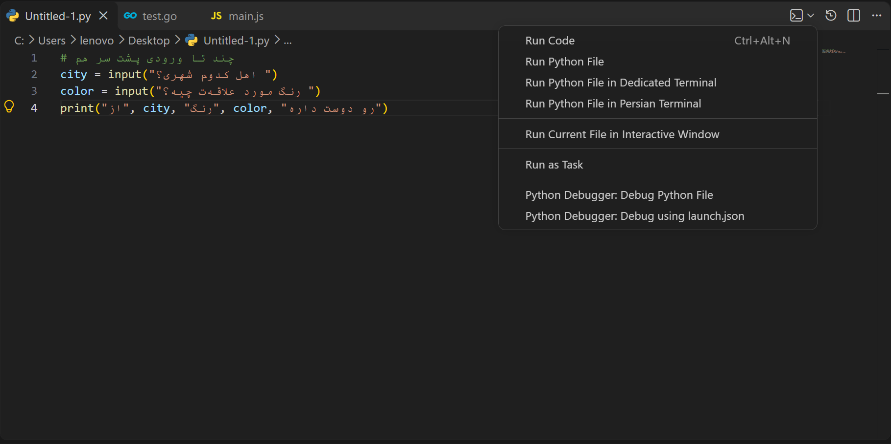
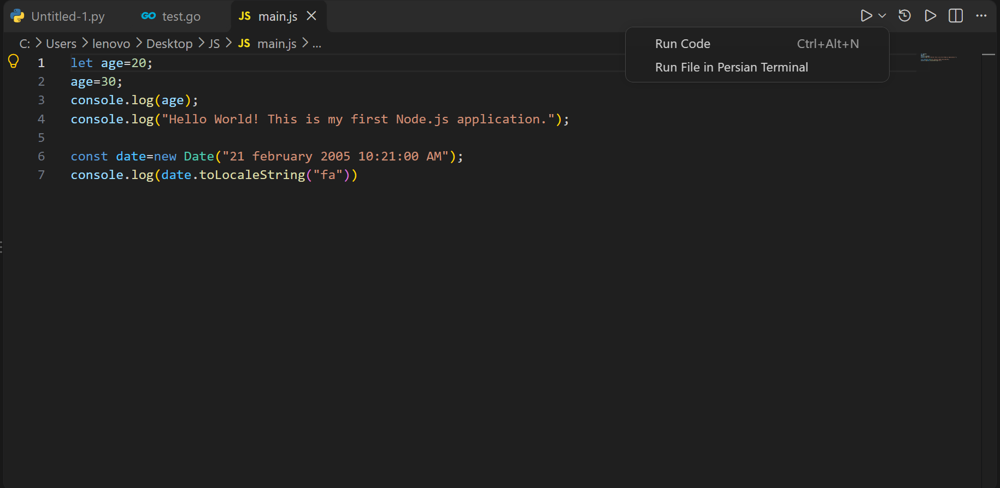
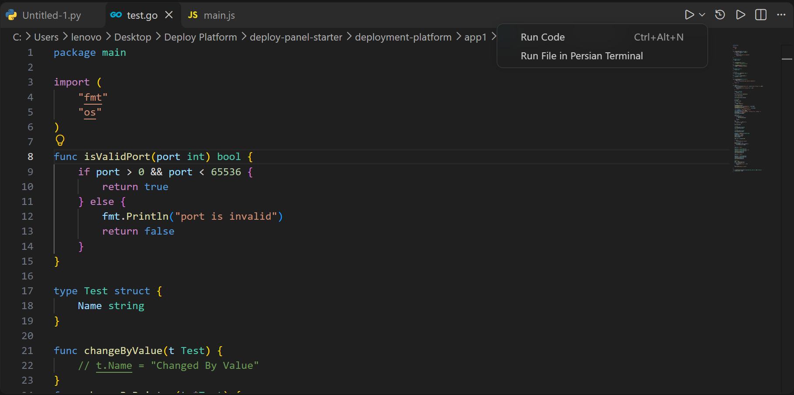
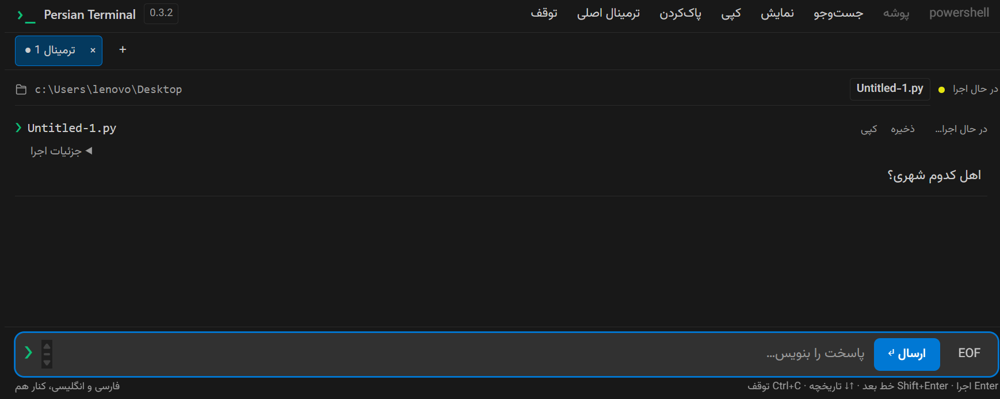

[English](README.md#english) · **فارسی**

<div dir="rtl" align="right">

<h1>ترمینال فارسی</h1>

<p><strong>فارسی را همان‌طور که باید، بخوان.</strong></p>

<p>دستور اجرا کنید، به پرسش‌های برنامه پاسخ دهید و خروجی فارسی را روان بخوانید. ترمینال فارسی، حروف متصل و چینش راست‌به‌چپ را در کنار دستورهای انگلیسی، در پنلی ساده داخل VS Code در اختیار شما می‌گذارد.</p>

<p></p>

<h2>امکانات</h2>

<ul>
<li><strong>فارسی خوانا:</strong> نمایش حروف متصل، چینش قابل تنظیم و فونت وزیرمتن، بدون نیاز به اینترنت برای بارگذاری فونت.</li>
<li><strong>اجرای مستقیم فایل:</strong> اجرای فایل‌های Python، Go، JavaScript، PHP، Ruby و Java از منوی ویرایشگر.</li>
<li><strong>یک تب برای هر فایل:</strong> خروجی فایل‌ها جدا می‌ماند و اجرای دوباره، همان تب را به کار می‌گیرد.</li>
<li><strong>شروع دوباره با یک انتخاب:</strong> با اجرای مجدد فایل، نشست قبلی بسته می‌شود و برنامه از ابتدا اجرا می‌شود؛ حتی وقتی منتظر ورودی است.</li>
<li><strong>حفظ خروجی برای مقایسه:</strong> نگه‌داشتن نتیجه اجراهای قبلی با یک گزینه در بخش «نمایش».</li>
<li><strong>ورودی تعاملی:</strong> ارسال پاسخ از داخل پنل و مرور پاسخ‌ها با برچسب کوچک «ورودی».</li>
<li><strong>نشست‌های مستقل:</strong> دستورهای دستی در تب عمومی اجرا می‌شوند و مسیر و متغیرهای محیطی میان دستورها باقی می‌مانند.</li>
<li><strong>جست‌وجو، کپی و ذخیره:</strong> پیدا کردن متن در تب جاری و دریافت خروجی هر اجرا به صورت جداگانه.</li>
<li><strong>نمایش مطابق سلیقه شما:</strong> تنظیم اندازه متن، فاصله‌ها و چینش فارسی.</li>
<li><strong>دسترسی به ترمینال اصلی:</strong> ادامه کار با ابزارهایی که به محیط تمام‌صفحه یا کلیدهای ویژه نیاز دارند.</li>
</ul>

<h2>شروع کار</h2>

<ol>
<li>افزونه Persian Terminal را در VS Code نصب کنید. برای فایل VSIX، دستور <bdi dir="ltr">Extensions: Install from VSIX</bdi> و سپس <bdi dir="ltr">Developer: Reload Window</bdi> را اجرا کنید.</li>
<li>پنجره فرمان‌ها را باز کنید و <bdi dir="ltr">Persian Terminal: Open</bdi> را انتخاب کنید.</li>
<li>یک شل نصب‌شده با Shell Integration فعال انتخاب کنید.</li>
<li>فایل خود را از منوی ویرایشگر اجرا کنید یا دستور را در کادر پایین پنل بنویسید.</li>
</ol>

<p>برای شروع، این پیام کوتاه را امتحان کنید:</p>
</div>

<div dir="ltr" align="left">

```sh
python -c "print('Hello from Persian Terminal!')"
```

</div>

<div dir="rtl" align="right">
<p>اگر فرمان پایتون در سیستم شما <code dir="ltr">python3</code> است، همان را جایگزین کنید. مفسر یا کامپایلر هر زبان باید جداگانه نصب شده باشد.</p>

<h2>اجرای فایل از ویرایشگر</h2>

<h3>پایتون</h3>
<p>فایل پایتون را باز کنید و از منوی اجرا یا کلیک راست، گزینه <bdi dir="ltr">Run Python File in Persian Terminal</bdi> را انتخاب کنید.</p>
<p></p>
<p>اگر <code dir="ltr">persianTerminal.pythonPath</code> تنظیم شده باشد، همان مفسر استفاده می‌شود. در غیر این صورت، مفسر انتخاب‌شده در افزونه Python بررسی می‌شود و در شرایط مناسب، محیط <code dir="ltr">.venv</code> یا پایتون سیستم به کار می‌رود. فایل پایتون از پوشه پروژه اجرا می‌شود؛ اگر پروژه‌ای باز نباشد، پوشه خود فایل مبنای اجراست.</p>

<h3>جاوااسکریپت، Go و زبان‌های دیگر</h3>
<p>برای فایل‌های Go، JavaScript، PHP، Ruby و Java از گزینه <bdi dir="ltr">Run File in Persian Terminal</bdi> استفاده کنید.</p>
<p></p>
<p></p>

<table dir="rtl">
<tr><th>زبان</th><th>روش اجرا</th></tr>
<tr><td>Python</td><td>مفسر انتخاب‌شده با خروجی بدون بافر</td></tr>
<tr><td>JavaScript</td><td><code dir="ltr">node file.js</code></td></tr>
<tr><td>Go</td><td><code dir="ltr">go run file.go</code></td></tr>
<tr><td>PHP</td><td><code dir="ltr">php file.php</code></td></tr>
<tr><td>Ruby</td><td><code dir="ltr">ruby file.rb</code></td></tr>
<tr><td>Java</td><td><code dir="ltr">java File.java</code> با محیطی که اجرای مستقیم فایل سورس را پشتیبانی کند</td></tr>
</table>

<p>این گزینه‌ها فایل انتخاب‌شده را اجرا می‌کنند. برای پروژه چندفایلی Go، دستور <code dir="ltr">go run .</code> و برای تست‌ها <code dir="ltr">go test</code> را در پوشه مناسب وارد کنید. دستورهای ساخت و زبان‌های دیگر نیز با نصب ابزار مربوط، به صورت دستی قابل اجرا هستند. پنل فارسی برای خروجی متنی طراحی شده است.</p>

<h2>تب‌ها، اجرای دوباره و حفظ خروجی</h2>

<p>هر فایل یک تب با نام خودش دارد. با اجرای فایل دیگر، خروجی فایل قبلی در تب خودش باقی می‌ماند. حداکثر هشت تب می‌تواند هم‌زمان باز باشد؛ برای ایجاد تب بعدی، یکی از تب‌های بدون استفاده را ببندید.</p>
<p>اجرای دوباره فایل، نشست تازه‌ای در همان تب ایجاد می‌کند. برنامه قبلی بسته می‌شود و تغییرات محیطی آن به نشست جدید منتقل نمی‌شود. خروجی قبلی به صورت پیش‌فرض پاک می‌شود.</p>
<p>برای مقایسه نتیجه‌ها، از بخش <strong>نمایش</strong> گزینه <strong>حفظ خروجی اجراهای قبلی</strong> را روشن کنید. انتخاب شما ذخیره می‌شود و از اجرای بعدی اعمال می‌شود؛ خاموش‌کردن گزینه، خروجی موجود را فوراً پاک نمی‌کند. تاریخچه در حافظه و با ظرفیت محدود نگهداری می‌شود؛ نتیجه‌های مهم را در فایل ذخیره کنید.</p>

<h2>پاسخ‌دادن به برنامه</h2>

<p></p>
<p>هنگام اجرای برنامه، کادر پایین برای ارسال پاسخ است. پاسخ را بنویسید و <strong>ارسال</strong> یا <bdi dir="ltr">Enter</bdi> را بزنید. برای شروع دوباره فایل، گزینه اجرای آن را از منوی ویرایشگر انتخاب کنید.</p>
<p>پاسخ‌ها با برچسب کوچک «ورودی» نمایش داده می‌شوند. پس از پایان اجرا، متن بعد از آخرین پاسخ با برچسب «خروجی» مشخص می‌شود. این برچسب‌ها بر اساس ترتیب رویدادها هستند و معنای متن برنامه را تشخیص نمی‌دهند. کپی و ذخیره شامل برچسب‌های نمایشی و ردیف‌های جداگانه ورودی نیست.</p>

<h2>ابزارهای روزمره</h2>

<ul>
<li><strong>نمایش:</strong> اندازه متن، فاصله‌ها، چینش فارسی و حفظ خروجی.</li>
<li><strong>پوشه:</strong> تغییر مسیر اجرای دستورها.</li>
<li><strong>جست‌وجو:</strong> پیدا کردن متن در تب جاری.</li>
<li><strong>کپی و ذخیره کنار اجرا:</strong> دریافت خروجی همان اجرا.</li>
<li><strong>پاک‌کردن:</strong> پاک‌کردن نمایش بدون بستن نشست شل.</li>
<li><strong>توقف:</strong> ارسال درخواست توقف به برنامه.</li>
<li><strong>ترمینال اصلی:</strong> بازکردن ترمینال زیرین در VS Code.</li>
<li><strong>دوبار کلیک روی نام تب:</strong> تغییر نام تب.</li>
</ul>

<p><strong>میانبرها:</strong> <bdi dir="ltr">Enter</bdi> برای اجرا یا ارسال، <bdi dir="ltr">Shift+Enter</bdi> برای خط بعد، کلیدهای بالا و پایین برای تاریخچه، <bdi dir="ltr">Ctrl+F</bdi> برای جست‌وجو و <bdi dir="ltr">Ctrl+L</bdi> برای پاک‌کردن نمایش. وقتی متنی انتخاب نشده باشد، <bdi dir="ltr">Ctrl+C</bdi> درخواست توقف می‌فرستد.</p>

<h2>راه‌اندازی و رفع مشکل</h2>

<ul>
<li>گزینه <code dir="ltr">terminal.integrated.shellIntegration.enabled</code> را فعال نگه دارید. در ویندوز از PowerShell 7 یا Git Bash و در لینوکس و مک از Bash، Zsh یا PowerShell 7 استفاده کنید.</li>
<li>اگر اتصال شل برقرار نشد، پیام راهنما در ترمینال اصلی را بررسی کنید. Windows PowerShell با PowerShell 7 متفاوت است.</li>
<li>اگر ابزار زبان پیدا نشد، نصب و دسترسی آن از شل را بررسی کنید. برای پایتون، <bdi dir="ltr">Python: Select Interpreter</bdi> یا تنظیم <code dir="ltr">persianTerminal.pythonPath</code> را بررسی کنید.</li>
<li>برای برنامه‌های تمام‌صفحه، ورود رمز مخفی و رابط‌های وابسته به کلیدهای جهت، از ترمینال اصلی استفاده کنید. خروجی‌هایی که مکان نشانگر را به شکل پیشرفته تغییر می‌دهند، ممکن است در پنل فارسی کامل نمایش داده نشوند.</li>
<li>بعضی برنامه‌ها درخواست توقف را نادیده می‌گیرند. بستن تب یا اجرای دوباره فایل، نشست آن‌ها را می‌بندد.</li>
<li>در حالت ترمینال اصلی، خروجی عادی و خطا در یک جریان دریافت می‌شوند.</li>
</ul>

<h2>توسعه و بازخورد</h2>

<pre dir="ltr" align="left"><code>npm ci
npm test
npm run package</code></pre>
<p>برای <a href="https://github.com/A-F-Rashidi/persian-terminal/issues">گزارش مشکل</a>، نام سیستم‌عامل، شل و نمونه کوتاهی از کدی که مشکل را نشان می‌دهد ارسال کنید.</p>
<p>این پروژه با مجوز MIT ارائه می‌شود.</p>

</div>
